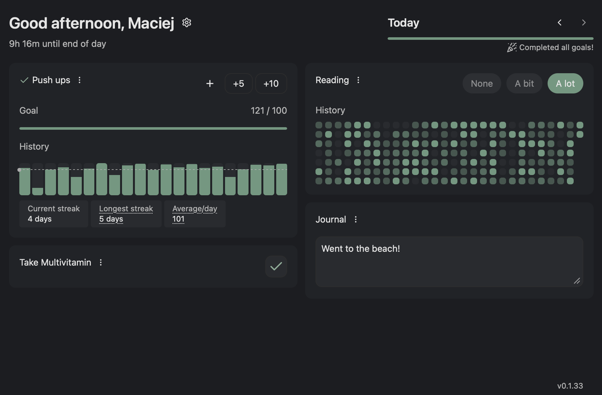
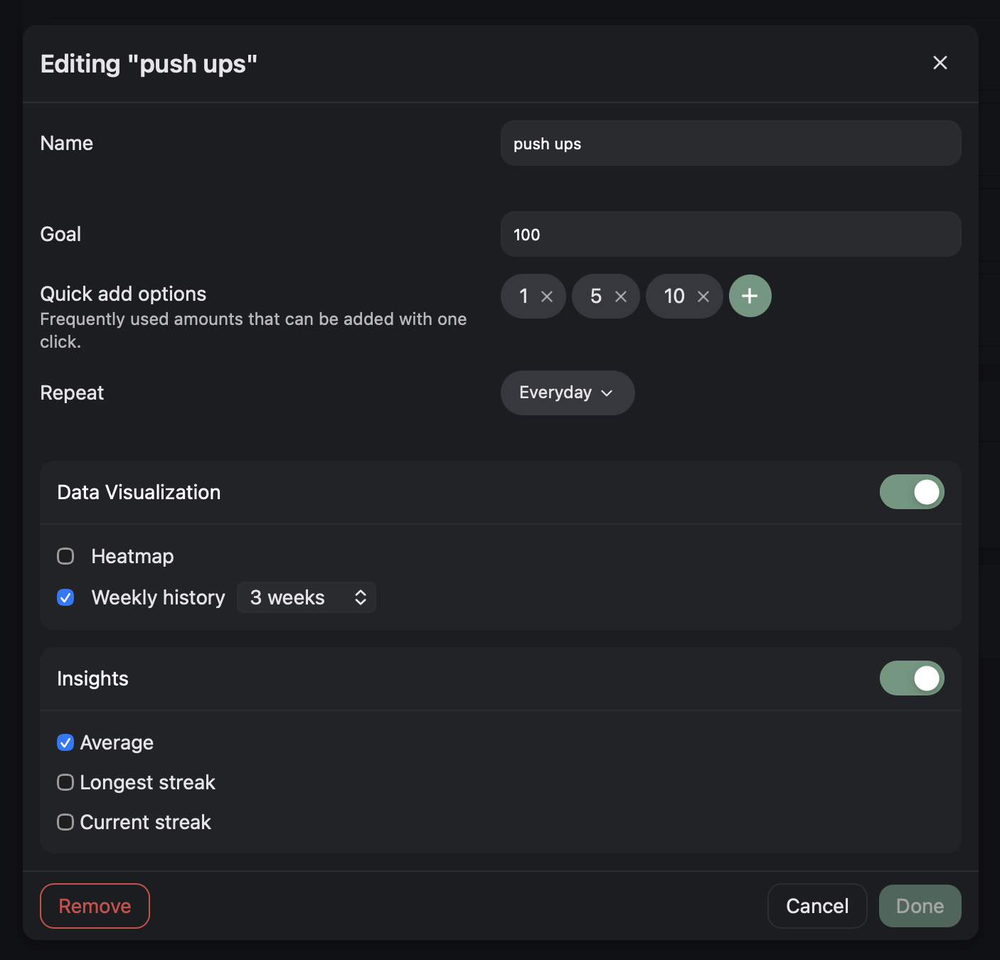

# Habsum

A self-hosted, highly configurable habit tracking dashboard.

<table align="center">
  <tr>
    <td width="50%">
      
    </td>
    <td width="50%">
      
    </td>
  </tr>
</table>

## Features

- **Self hostable**. Docker friendly out of the box.
- **GUI to easily edit habits**. You can also modify things in YAML.
- **Light & Dark modes**. And mobile-web friendly.
- **Multiple user support**.
- **Various types of habit "types", data visualizations & "insights"**. Pick and choose how you want to view/record your habits.
