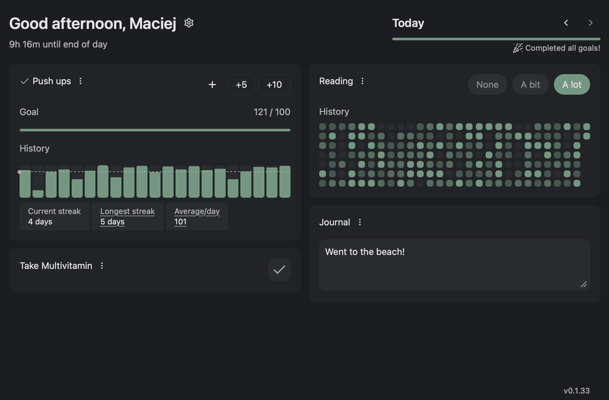
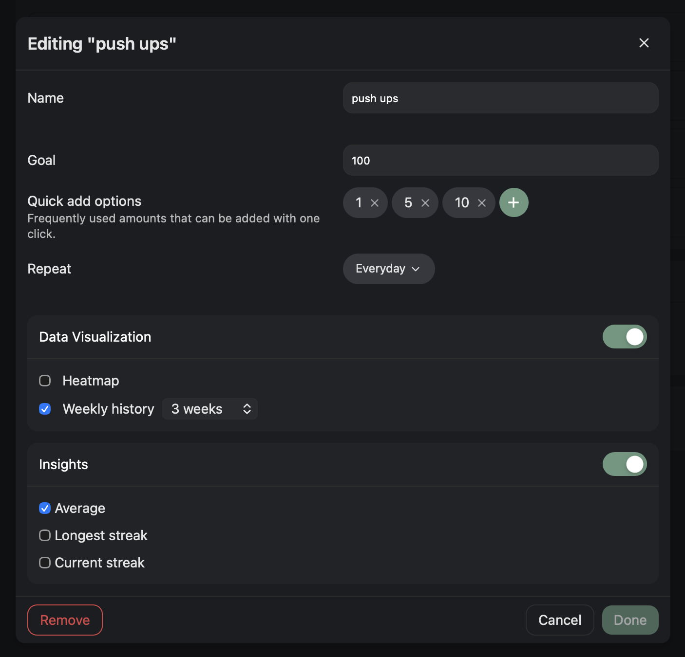
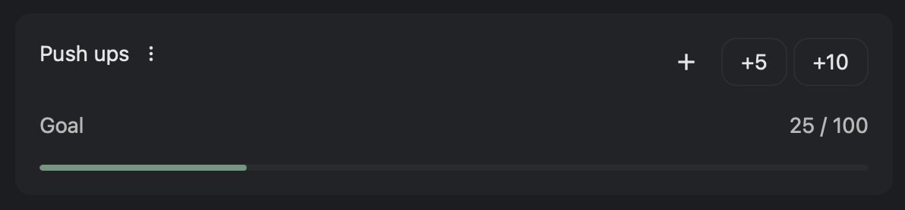
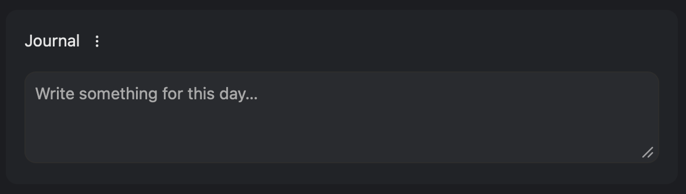
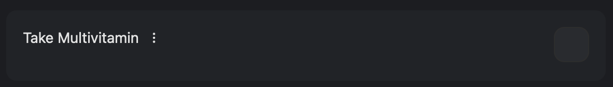
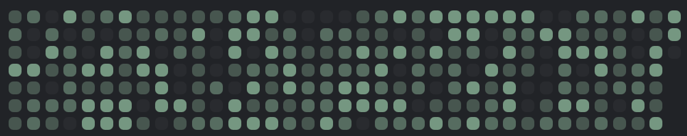
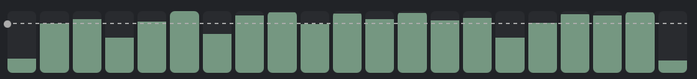
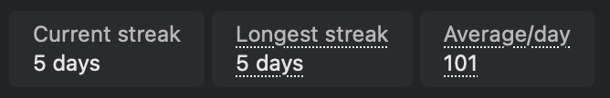

# Habsum

A self-hosted, highly configurable habit tracking dashboard.

<table align="center">
  <tr>
    <td width="50%">
      
    </td>
    <td width="50%">
      
    </td>
  </tr>
</table>

## Features

- **Self hostable**.
- **GUI editor for habits**. Or modify the YAML file directly.
- **Dark & Light modes**. And mobile-web friendly.
- **Multiple user support**.
- **Various types of habit "types", data visualizations & "insights"**. Pick and choose how you want to view/record your habits.

## Habit types

<table>
  <tr>
    <td width="60%">
      <h4>Summation</h4>
      <p>Configurable with optional "goal", and "quick add" buttons. Repeat on speccific days.</p>
    </td>
    <td width="40%">
      
    </td>
  </tr>
  <tr>
    <td width="60%">
      <h4>Note</h4>
      <p>Configurable to clear on a specific day of the week.</p>
    </td>
    <td width="40%">
      
    </td>
  </tr>
    <tr>
    <td width="60%">
      <h4>Single select</h4>
      <p>Pick one option from a list. </p>
    </td>
    <td width="40%">
      
    </td>
  </tr>
    <tr>
    <td width="60%">
      <h4>Checkbox</h4>
      <p>A variant of the single select when the only options are yes & no</p>
    </td>
    <td width="40%">
      
    </td>
  </tr>
</table>

## Data visualizations

<table>
  <tr>
    <td width="33%">
      
      <h4>Heatmap</h4>
    </td>
    <td width="33%">
      
      <h4>Bar graph</h4>
    </td>
        <td width="33%">
      
      <h4>Insights</h4>
    </td>
  </tr>
</table>

## Quick start with Docker

```bash
mkdir ./habsum && cd ./habsum
wget -O compose.yml https://raw.githubusercontent.com/mlisbit/habsum/main/docker/compose.yml
docker compose up -d
```

You can find more detailed instructions at [`habsum.com/docs`](https://habsum.com/docs/) or [`/docs/overview/quick-start.md`](/docs/overview/quick-start.md)

## Development

`docker compose -f docker/compose.dev.yaml up --build`

More docs available in [`/docs/development.md`](/docs/development.md)
