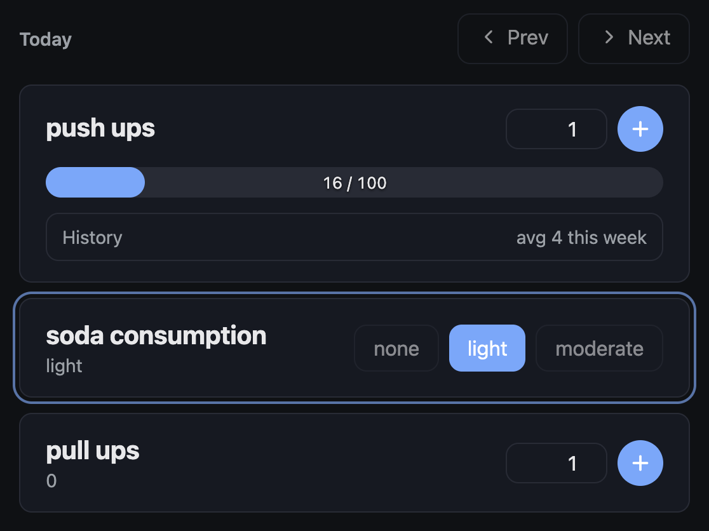

# Habsum

<p align="center">
  
</p>

A self-hosted YAML configurable habit tracking dashboard.

## Features

- **YAML-configured users & habits**: define habits per user in `${HABSUM_CONFIG_DIR}/users/*.yaml`.
- **SQLite persistence**: totals are stored in `${HABSUM_CONFIG_DIR}/habsum.db`.
- **Dashboard UI**: pick a user and update habit totals from the browser.
- **Widgets**: habits can be rendered as either a counter (summation) or a quick-action button.
- **Docker-friendly**: run the server in a container with a bind-mounted data directory.

## Example configuration



```yaml
habits:
  push ups:
    type: summation
    goal: 100
    data_visualization:
      bargraph:
        period: 1w
    insights:
      - average

  soda consumption:
    type: single_select
    options: [none, light, moderate]

  pull ups:
    type: summation
```

## Deploy via Docker

Use this single `docker compose` file (it runs **server + webapp** on one stack):

```yaml
services:
  server:
    image: ghcr.io/mlisbit/habsum/habsum-server:main
    environment:
      PORT: '3001'
      HABSUM_CONFIG_DIR: /data
    volumes:
      - ./data:/data
    expose:
      - '3001'

  web:
    image: ghcr.io/mlisbit/habsum/habsum-webapp:main
    ports:
      - '8882:3000'
    depends_on:
      - server
```

### Start

```bash
mkdir -p data/users

docker compose up -d
```

Open `http://localhost:8882`.
